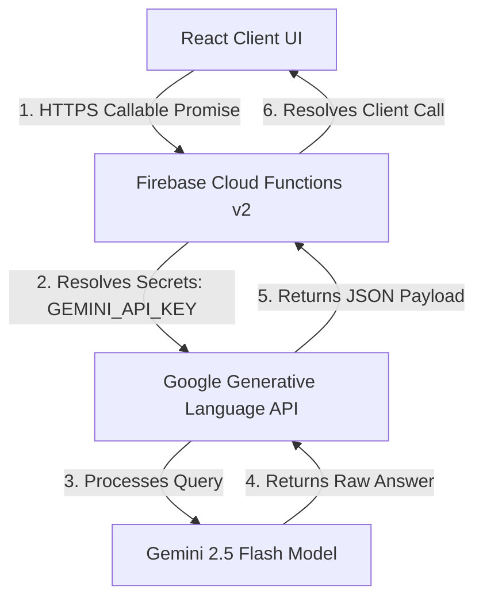

# 🛡️ CyberShield

<p align="center">
  
</p>

<h3 align="center">Protect Before You Click.</h3>

<p align="center">
  CyberShield is a privacy-focused personal cybersecurity sandbox designed to help users inspect potentially dangerous digital content before interacting with it. It provides a secure environment to audit URLs, phishing texts, files, and QR codes using client-side processing and secure backend AI proxies.
</p>

<p align="center">
  
  
  
  
  
  
  
</p>

<p align="center">
  <a href="https://github.com/MuhammedSijan/CyberShield"><strong>GitHub Repository</strong></a> |
  <a>Live Demo (Local Only)</a>
</p>

---

## 2. Overview

In today's digital landscape, users frequently encounter suspicious links, malicious file payloads, phishing attempts, and unsafe QR redirects. **CyberShield** acts as a personal security sandbox, allowing users to safely copy-paste or upload digital assets to analyze them *before* they cause harm. 

The application prioritizes **client-side security analysis** and user privacy:
*   **Zero File Uploads:** Files are analyzed in the browser. Only the cryptographic hash (SHA-256) and basic metadata are queried externally.
*   **Zero Password Sharing:** Raw passwords are never transmitted. Complexity calculations run locally, and AI explanations are requested using derived metrics only.
*   **No Auto-Execution:** Decoded QR code links and suspicious files are presented in isolated diagnostic containers, preventing automatic system executions or browser redirects.

---

## 3. Key Features

CyberShield delivers seven specialized security modules and interactive dashboards to build a comprehensive digital safety report:

### 🔗 URL Safety Analyzer
*   Checks hyperlinks for protocol enforcement (HTTP vs HTTPS), domain length, and subdomain nesting.
*   Flags typosquatting anomalies (e.g., `g00g`, `paypaI`) and known spoof keywords (`login`, `secure`, `verify`).
*   Queries the VirusTotal v3 API for real-time URL reputation statistics.
*   Applies Gemini AI to yield detailed risk summaries, warning indicators, and mitigation guidelines.

### 🎣 Phishing Message Detector
*   Audits email headers, SMS payloads, and chat logs for social engineering markers.
*   Flags semantic indicators such as urgent threats, panic triggers, and false greed rewards (lotteries, cash prizes).
*   Combines local regex checks with Gemini AI to dissect manipulation tactics and advise on blocking/reporting procedures.

### 📁 File Safety Analyzer
*   Computes file SHA-256 checksums entirely within the browser using the Web Crypto API.
*   Inspects file metadata for risk indicators like double extensions (e.g., `invoice.txt.exe`), archived packages (`.zip`, `.7z`), large sizes, and executable MIME types.
*   Queries the VirusTotal v3 database using the SHA-256 hash (never uploading the actual file).
*   Provides Gemini-driven forensic reports outlining potential payloads and warning flags.

### 🔐 Password Health Checker & Generator
*   **Checker:** Checks complexity factors (mixed cases, numbers, symbols, length >= 12, repeating character clusters, common dictionary patterns) locally. Calculates estimated crack times.
*   **Privacy-First AI Audit:** Sends only boolean complexity metrics and lengths to Gemini AI to generate security recommendations, keeping the password completely private.
*   **Generator:** Creates cryptographically secure random passwords locally in batches of five using the `crypto.getRandomValues` Web API, letting users configure custom rules (exclude similar characters, include symbols, etc.).

### 📱 QR Code Safety Checker
*   Decodes uploaded QR code images (PNG, JPG, SVG) locally in the browser sandbox.
*   Checks if the decoded string is a web redirection URL.
*   Audits redirection URLs against the VirusTotal v3 engine.
*   **Safety Boundary:** Displays decoded targets and safety recommendations without automatically loading the URL, neutralizing drive-by download exploits. Provides a button to analyze the URL manually in the URL Analyzer.

### 🛡️ Security Hub
*   Acts as a central dashboard providing quick navigation to all diagnostic modules.
*   Aggregates live security metrics: modules active, browser safety index, and total report counts.
*   Streams dynamic, session-wide security posture assessments analyzed by Gemini.

### 📊 Security Report Dashboard
*   Calculates a session-specific **Cyber Safety Score** based on checked elements.
*   Aggregates diagnostic statistics (total scans, safe/suspicious/dangerous counts, and quiz progress).
*   Generates a dynamic **ShieldAI Security Briefing** detailing core threat focus areas and actionable mitigations.
*   Enables users to download a comprehensive PDF report of all logged activities.

---

## 4. ShieldAI

**ShieldAI** is CyberShield's integrated artificial intelligence security advisor, powered by Google's `gemini-2.5-flash` model. 

It provides two distinct features:
1.  **Context-Aware Posture Advisory:** Runs silently on the Dashboard and Security Hub, examining your active scan records and overall Safety Score to build a personalized threat brief.
2.  **Interactive Security Assistant:** A floating chat assistant widget located in the bottom-right corner. It allows users to ask questions about threat remediation, cybersecurity policies, or general advice. It automatically consumes current session statistics and recent threats to provide highly context-specific safety guidelines.

### AI Proxy Architecture

Client credentials must never be exposed to the browser. ShieldAI leverages a server-side gateway:



By querying the model via Cloud Functions (`shieldAssistantProxy` and `securityAdvisoryProxy`), the application secures the Google API keys and enforces strict validation boundaries.

---

## 5. Security Architecture

```
┌────────────────────────────────────────────────────────┐
│                      FRONTEND LAYER                    │
│   React 19  •  TypeScript  •  Vite  •  Tailwind CSS     │
│   Client-Side Crypto Hashing & Heuristics Sandbox      │
└───────────────────────────┬────────────────────────────┘
                            │ (Secure HTTPS Callables)
                            ▼
┌────────────────────────────────────────────────────────┐
│                   FIREBASE BACKEND LAYER               │
│   Firebase Auth  •  Firestore  •  App Check Boundary   │
│   Cloud Functions v2 (Proxy Gateway Enforcing App Check)│
└───────────────────────────┬────────────────────────────┘
                            │ (Secret API Keys Integration)
                            ▼
┌────────────────────────────────────────────────────────┐
│                     EXTERNAL APIS                      │
│   Google Gemini 2.5 Flash   •   VirusTotal v3 API     │
└────────────────────────────────────────────────────────┘
```

### Key Architectural Layers:
1.  **Frontend (Client Sandbox):** Runs all high-performance interface logic, Framer Motion animations, local password checks, file SHA-256 computations, and QR code decoding.
2.  **Firebase Cloud Functions (Backend Proxies):** All AI queries and VirusTotal database lookups pass through secure Firebase Functions:
    *   `analyzeUrlProxy`: Performs DNS checks, queries VirusTotal v3 domain reports, and runs Gemini evaluation.
    *   `analyzePhishingProxy`: Evaluates message text via Gemini 2.5 Flash.
    *   `analyzeFileProxy`: Processes metadata and SHA-256 hash checks via VirusTotal and Gemini.
    *   `analyzeQrProxy`: Audits decoded QR redirection links.
    *   `explainPasswordProxy`: Evaluates password metadata profiles without exposing raw strings.
    *   `securityAdvisoryProxy` / `shieldAssistantProxy`: Drives the ShieldAI security briefing and chatbot sessions.
3.  **App Check Gateway:** Ensures only verified client requests can reach Cloud Functions and Firestore.
4.  **Privacy-Centric Database Models:** Firestore stores user credentials and history reports securely. In **Guest Mode (Anonymous Login)**, all databases and user credentials are automatically deleted from Firestore and Firebase Authentication upon logging out.

---

## 6. Firebase App Check

To defend backend Firebase resources from abuse and replay attacks, CyberShield implements **Firebase App Check**:
*   **Production:** Leverages **Google reCAPTCHA v3**. Clients must present a valid reCAPTCHA token verified by Google servers before Firebase Cloud Functions will execute.
*   **Local Development:** Configured with a local App Check Debug Token. In dev mode (`import.meta.env.DEV`), the app dynamically registers:
    ```typescript
    self.FIREBASE_APPCHECK_DEBUG_TOKEN = true;
    ```
    This instructs the SDK to print a local debug token to the developer console. The token must be registered in the Firebase Console under App Check settings to allow the developer's local client to query backend services.

---

## 7. Security Modules

The following modules make up the CyberShield diagnostic workspace:

| Module | Core Purpose | Client-Side Logic | Server-Side Proxy Logic |
| :--- | :--- | :--- | :--- |
| **URL Safety Analyzer** | Scan domains for malicious indicators and phishing campaigns. | HTTP/HTTPS validation, keyword spoof checks, typosquatting detection. | VirusTotal API v3 URL check & Gemini 2.5 Flash analysis. |
| **Phishing Detector** | Identify social-engineering and credential harvesting tactics. | Hyperlink presence checks, linguistic keyword scans. | Gemini 2.5 Flash text evaluation. |
| **File Safety Analyzer** | Audit files for hidden extensions, archives, and malicious hashes. | SHA-256 hash generation (Web Crypto API), double extension check. | VirusTotal API v3 hash lookup & Gemini 2.5 Flash forensics. |
| **Password Health Checker** | Evaluate complexity, entropy, and crack time. | Length, uppercase, lowercase, numbers, symbols, pattern repetitions, common words. | Gemini analysis using metadata flags only (no password string sent). |
| **Password Generator** | Generate high-entropy, secure passphrases. | `crypto.getRandomValues` Web API, custom parameter filters. | *Fully Local (No network requests)* |
| **QR Code Scanner** | Decode and verify QR code redirections safely. | Local image extraction and decoding. Redirection check. | VirusTotal URL check & Gemini analysis of target redirect URL. |
| **Cyber Hygiene Quiz** | Gamify cybersecurity awareness. | Scenario matching, score calculations, badge awards. | *Fully Local (No network requests)* |

---

## 8. Security Posture / Scoring

The Cyber Safety Score is a **dynamic, application-level metric** generated by CyberShield. It is not an industry-standard security benchmark, but serves to illustrate the user's active exposure level during a session.

### Score Progression Logic:
*   Initial Baseline: **`100%`**
*   Score updates based on diagnostic results:
    *   **URL, Phishing, QR, File Scans:** Safe (`+2%`), Suspicious (`-5%`), Danger/Blocked (`-10%`).
    *   **Password Health Checks:** Safe (`+2%`), Suspicious (`-2%`), Danger/Weak (`-5%`).
    *   **Hygiene Quiz Completions:** Adds (`+5%`) to overall score.
    *   **Password Generator Executions:** Adds (`+2%`) for practicing healthy rotation habits.
*   Clamping: The final score is always clamped between a minimum of **`0%`** and a maximum of **`100%`**.
*   **Firestore Synchronization:** When authenticated, user scores and total scan counts are updated under `users/{uid}/stats/securityScore`.

---

## 9. Dashboard Layout

The **Dashboard** compiles diagnostic metrics into a unified, glassmorphic display:
*   **Cyber Safety Score Radial Meter:** Displays the percentage score, accompanied by a dynamic classification badge:
    *   `90% - 100%`: **Sentinel (B to A+)** (Color: Emerald/Blue)
    *   `40% - 89%`: **Caution (C)** (Color: Amber)
    *   `< 40%`: **Critical (D)** (Color: Rose)
*   **ShieldAI Security Briefing Card:** Dynamically loads Focus Threat Areas (threats flagged in the session) and Actionable Mitigations.
*   **Activity Summary Grid:** Displays scan counters (total scans, safe/suspicious ratio, dangerous blocks, and quiz averages).
*   **Recent Activities Log:** Lists recent scans with direct navigation icons to review detailed reports.
*   **Diagnostic Controls:** Clean actions to sync metrics manually, clear Firestore diagnostic history, or generate a PDF report.

---

## 10. Technology Stack

| Technology | Implementation Scope | Package Version |
| :--- | :--- | :--- |
| **React** | Frontend UI library | `^19.2.8` |
| **TypeScript** | Type-safe language support | `~6.0.2` |
| **Vite** | Build tool and dev server | `^8.2.0` |
| **Tailwind CSS** | Styling and layout design system | `^3.4.19` |
| **Framer Motion** | Dynamic UI page transitions and scanner animations | `^12.43.0` |
| **Lucide React** | Scalable security iconography | `^1.28.0` |
| **Firebase Auth** | Email/Password, Google OAuth, and Anonymous Guest access | `^12.17.1` (Client) |
| **Cloud Firestore** | Storing profile details, settings, and scan histories | `^12.17.1` (Client) |
| **Cloud Functions v2** | Secured server-side AI caller proxies and VT integrations | `^6.0.1` (Functions Node SDK) |
| **Gemini AI API** | Large language threat parsing and chatbot queries | `gemini-2.5-flash` model |
| **VirusTotal API** | Cryptographic hash lookups and URL security analysis | `v3` REST Endpoint |
| **Firebase App Check** | Security boundaries (reCAPTCHA v3 & dev debug token) | `^12.17.1` (Client) |

---

## 11. Project Structure

```
MuhammedSijan/CyberShield/
├── functions/                     # Firebase Cloud Functions (v2 backend code)
│   ├── src/
│   │   ├── utils/
│   │   │   ├── gemini.ts          # Gemini API HTTP communication logic
│   │   │   └── vt.ts              # VirusTotal v3 endpoints communication logic
│   │   ├── advisory.ts            # securityAdvisoryProxy function
│   │   ├── assistant.ts           # shieldAssistantProxy chatbot function
│   │   ├── file.ts                # analyzeFileProxy function
│   │   ├── index.ts               # Cloud Functions exports
│   │   ├── password.ts            # explainPasswordProxy function
│   │   ├── phishing.ts            # analyzePhishingProxy function
│   │   ├── qr.ts                  # analyzeQrProxy function
│   │   └── url.ts                 # analyzeUrlProxy function
│   ├── package.json
│   └── tsconfig.json
├── src/                           # Client React application
│   ├── assets/                    # Static assets & icons
│   ├── components/
│   │   └── common/
│   │       ├── AuthGuard.tsx      # Protected route wrapper
│   │       ├── Navbar.tsx         # Responsive main navigation
│   │       ├── ShieldAssistant.tsx# Floating ShieldAI Chat widget
│   │       └── StepProgressScanner.tsx # Scan animation states
│   ├── context/
│   │   ├── AuthContext.tsx        # Firebase Authentication context
│   │   └── SecurityContext.tsx    # Scan logs context & scoring formula
│   ├── data/
│   │   ├── mockData.ts            # Mock templates for URL/phishing checks
│   │   └── quizQuestions.ts       # Cybersecurity Hygiene quiz database
│   ├── firebase/
│   │   ├── firebase.ts            # Firebase Client initialization & App Check
│   │   └── scanService.ts         # Firestore history logs saving service
│   ├── hooks/
│   │   └── useToast.tsx           # Global action toast notifications
│   ├── layouts/
│   │   └── MainLayout.tsx         # Dashboard page layout shell
│   ├── pages/
│   │   ├── Auth.tsx               # Login, Sign Up, and Guest access portal
│   │   ├── Dashboard.tsx          # Real-time report, score, and PDF generator
│   │   ├── FileSafetyAnalyzer.tsx # Browser file hash sandbox
│   │   ├── PasswordChecker.tsx    # Password health evaluator
│   │   ├── PasswordGenerator.tsx  # Cryptographic password batch builder
│   │   ├── PhishingDetector.tsx   # Urgency and threat message analyzer
│   │   ├── QrScanner.tsx          # QR image scanner and warning layout
│   │   ├── Quiz.tsx               # Security Hygiene Quiz
│   │   ├── SecurityHub.tsx        # Center navigation dashboard
│   │   └── Settings.tsx           # Theme & local storage configurations
│   ├── App.tsx                    # React router route registry
│   ├── index.css                  # Tailwinds design parameters
│   └── main.tsx                   # React root rendering mount
├── firebase.json                  # Firebase service configurations & emulator ports
├── package.json                   # Frontend dependencies
├── tailwind.config.js             # Styling configuration
└── vite.config.ts                 # Vite compiler settings
```

---

## 12. Getting Started

Follow these steps to configure and run the CyberShield sandbox on your local machine:

### Prerequisites
1.  **Node.js**: Install Node.js (v20+ recommended).
2.  **npm**: Installed automatically with Node.js (v10+ recommended).
3.  **Firebase CLI**: Install the Firebase command-line tools globally to run the emulator:
    ```bash
    npm install -g firebase-tools
    ```

### Installation
1.  Clone the repository:
    ```bash
    git clone https://github.com/MuhammedSijan/CyberShield.git
    cd CyberShield
    ```
2.  Install frontend dependencies:
    ```bash
    npm install
    ```
3.  Install backend Cloud Functions dependencies:
    ```bash
    cd functions
    npm install
    cd ..
    ```

### Environment Variables
You must create environment variable files in both the frontend root and the `functions/` directory.

#### Client Configuration (`.env` in the root folder):
Create a `.env` file in the root directory and add the following keys matching your client web application registered in the Firebase console:
```env
VITE_FIREBASE_API_KEY=your_firebase_api_key
VITE_FIREBASE_AUTH_DOMAIN=your_firebase_auth_domain
VITE_FIREBASE_PROJECT_ID=your_firebase_project_id
VITE_FIREBASE_STORAGE_BUCKET=your_firebase_storage_bucket
VITE_FIREBASE_MESSAGING_SENDER_ID=your_firebase_sender_id
VITE_FIREBASE_APP_ID=your_firebase_app_id
VITE_RECAPTCHA_SITE_KEY=your_recaptcha_v3_site_key
```

#### Backend Configuration (`.env` in the `functions/` folder):
Create a `.env` file inside the `functions/` directory and configure the API key access parameters:
```env
GEMINI_API_KEY=your_google_gemini_api_key
VIRUSTOTAL_API_KEY=your_virustotal_api_key
```

---

## 13. Firebase / Functions Development

CyberShield leverages the local Firebase Emulator Suite to run and debug backend functions locally without incurring costs or hitting cloud execution quotas.

### Running Backend Emulators Locally
1.  Navigate to the `functions/` directory and compile the TypeScript compiler:
    ```bash
    cd functions
    npm run build
    ```
2.  Start the Firebase Functions emulator from the root directory:
    ```bash
    firebase emulators:start --only functions
    ```
    This launches the emulator server locally on port `5001`.
3.  **Vite Client Dev Detection:** In Vite's local dev mode (`npm run dev`), the client SDK detects the environment and automatically redirect functions queries to the local port:
    ```typescript
    if (import.meta.env.DEV) {
        connectFunctionsEmulator(functions, "127.0.0.1", 5001);
    }
    ```

### Production Deployment
*Note: The project is currently being developed and tested locally.* 

To deploy functions and security configurations to your live Firebase project, execute:
```bash
# Deploy Firebase Cloud Functions
firebase deploy --only functions

# Deploy Firestore Security Rules
firebase deploy --only firestore:rules
```

---

## 14. Build Verification

To confirm that the project compiles cleanly without TypeScript errors or lint issues, execute the following build steps:

### Verify Client Build:
```bash
npm run build
```
This runs the TypeScript compiler and compiles the Vite production bundles inside the `dist/` folder.

### Verify Backend Functions Build:
```bash
cd functions
npm run build
```
This transpiles TypeScript files into pure JavaScript bundles in `functions/lib/index.js` ready for emulator execution.

---

## 15. Privacy & Security Policies

CyberShield is built on the principle of minimal data collection:
*   **API Boundary isolation:** All external calls to Gemini AI and VirusTotal are routed through Cloud Functions. The client application never interacts with third-party servers directly, preventing browser cookies, trackers, or trackers footprint leakage.
*   **Data Integrity:** Raw file streams and password content strings remain on the client device. The browser only processes structural markers (e.g. extension syntax, password characters type distribution) and cryptographic hashes.
*   **Disclaimer:** CyberShield is designed as a personal security sandboxing assistance tool to educate and flag potential risks. It is not an absolute security guarantee and does not replace enterprise-level antivirus software, Endpoint Detection and Response (EDR) agents, Security Operations Centers (SOC), or professional security auditing.

---

## 16. Limitations

*   **Heuristic Detections:** Local scanners use heuristic rules (checks for keywords, extensions, and entropy). A file or link marked "Safe" might still contain zero-day payloads or highly sophisticated obfuscation elements.
*   **AI Detections:** ShieldAI diagnostics rely on model reasoning. AI outputs should be cross-referenced with dedicated threat engines, as Large Language Models can produce hallucinations.
*   **Camera Mockup:** The live video feed in the QR Code Safety Checker is currently a UI placeholder. Live scanning requires configuring camera capture media feeds, though QR code image upload is fully functional.
*   **VirusTotal Key Quotas:** Under default configurations, VirusTotal lookup requests are limited by free API key rate limits (e.g. 4 requests/min). Exceeding this triggers lookup fallback alerts.

---

## 17. Development Status

🚧 **Active Local Development / Testing**

CyberShield is actively developed to expand personal cybersecurity sandboxing capabilities. Features, AI detection models, local scoring algorithms, and security libraries continue to be refined.

---

## 18. Roadmap

- [x] Core sandboxing analysis modules (URL, File, QR, Phishing)
- [x] Local Password checker and Cryptographic generator
- [x] Security Hub workspace directory
- [x] Dynamic Cyber Safety Score calculations and Radial meters
- [x] ShieldAI personalized security briefs
- [x] ShieldAI floating chat assistant widget
- [x] Firebase Authentication sync & Guest user database auto-purging
- [x] App Check boundary configuration (reCAPTCHA v3 & local debug)
- [x] Session exportable JSON log files and PDF download generators
- [ ] Connect device camera streaming API for live QR scanning
- [ ] Integrate local file binary analysis libraries in WebAssembly
- [ ] Deploy production cloud hosting environment

---

## 19. Contributing

Contributions to CyberShield are welcome! Follow these steps to submit edits:
1.  Fork the repository (`https://github.com/MuhammedSijan/CyberShield`).
2.  Create a branch for your feature (`git checkout -b feature/AmazingFeature`).
3.  Implement and test your changes (verify compile state using `npm run build`).
4.  Commit your modifications (`git commit -m 'Add AmazingFeature'`).
5.  Push to the branch (`git push origin feature/AmazingFeature`).
6.  Open a Pull Request.

---

## 20. License

License information has not yet been added.
